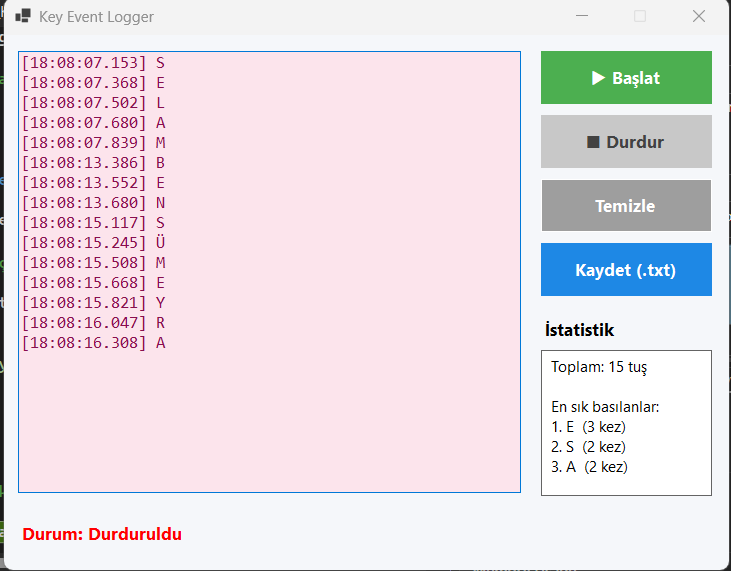
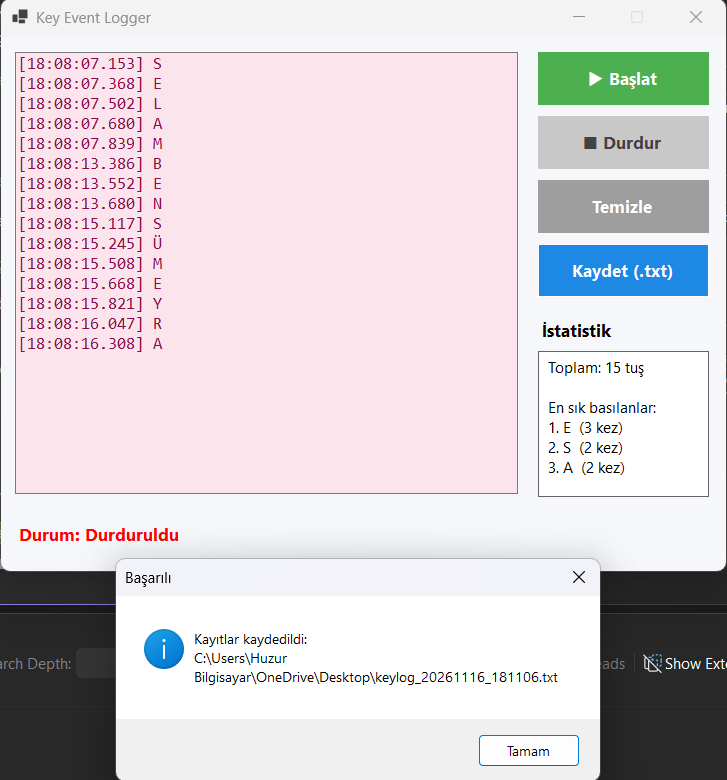

# YMH219 - Key Event Logger

Nesne Tabanlı Programlama (YMH219) dersi kapsamında geliştirilmiş, eğitsel amaçlı bir klavye olay kaydedicisidir. Uygulama **yalnızca kendi penceresi aktifken** basılan tuşları zaman bilgisiyle birlikte listeler ve isteğe bağlı olarak `.txt` dosyasına kaydeder.

> ⚠️ Bu uygulama gerçek bir sistem keylogger'ı değildir. Global klavye kancası (hook), arka planda gizli çalışma, başlangıçta otomatik açılma, başka uygulamalardan veri toplama veya ağ üzerinden veri gönderme **içermez**.

## Kullanılan Teknolojiler

- C# / .NET 10
- Windows Forms
- Visual Studio 2022
- Ek NuGet paketi kullanılmamıştır

## Kurulum ve Çalıştırma

1. Depoyu klonlayın:
   ```bash
   git clone https://github.com/Sumeyraadiyaman/YMH219-KeyEventLogger.git
   ```
2. `YMH219-KeyEventLogger.slnx` dosyasını Visual Studio 2022 ile açın.
3. Visual Studio'da ".NET desktop development" iş yükünün kurulu olduğundan emin olun.
4. `F5` tuşu ile uygulamayı çalıştırın.

## Özellikler

- **Başlat / Durdur:** Kayıt durumunu kontrol eder; pasif olan buton gri görünür.
- **Tuş kaydı:** Basılan tuş ve milisaniye hassasiyetinde zaman bilgisi listelenir.
- **Türkçe karakter desteği:** Ü, Ğ, Ş, İ, Ö, Ç gibi harfler `KeyPress` olayı ile doğru gösterilir.
- **Durum göstergesi:** Yeşil = kayıt yapılıyor, kırmızı = durduruldu.
- **Temizle:** Onay alındıktan sonra tüm kayıtları siler.
- **Kaydet (.txt):** Kayıtları kullanıcının seçtiği konuma metin dosyası olarak kaydeder.
- **İstatistik (ek özellik):** Toplam tuş sayısı ve en sık basılan 3 tuş canlı olarak gösterilir.
- **Hata yönetimi:** Dosya kaydı başarısız olursa uygulama kapanmaz, kullanıcıya hata mesajı gösterilir.

## Proje Yapısı

| Dosya | Açıklama |
|---|---|
| `KeyRecord.cs` | Tek bir tuş olayını (tuş, karakter, zaman) temsil eden sınıf |
| `Form1.cs` | Olay yönetimi, kayıt, dosyaya yazma ve istatistik işlemleri |
| `Form1.Designer.cs` | Arayüz bileşenleri |

## Ekran Görüntüleri

**Ana ekran**



**Dosyaya kaydetme**



## Bilinen Sınırlamalar / Geliştirme Notları

- `Tab` tuşu, Windows tarafından kontroller arası geçiş için kullanıldığından listeye düşmez.
- Kayıtlar yalnızca bellekte tutulur; kaydedilmeden uygulama kapatılırsa kaybolur.
- Geliştirme fikri: Kayıtları tarih/saat aralığına göre filtreleme.

## Öğrenci

- **Ad Soyad:** Sümeyra Adıyaman
- **Öğrenci No:** 250541012
